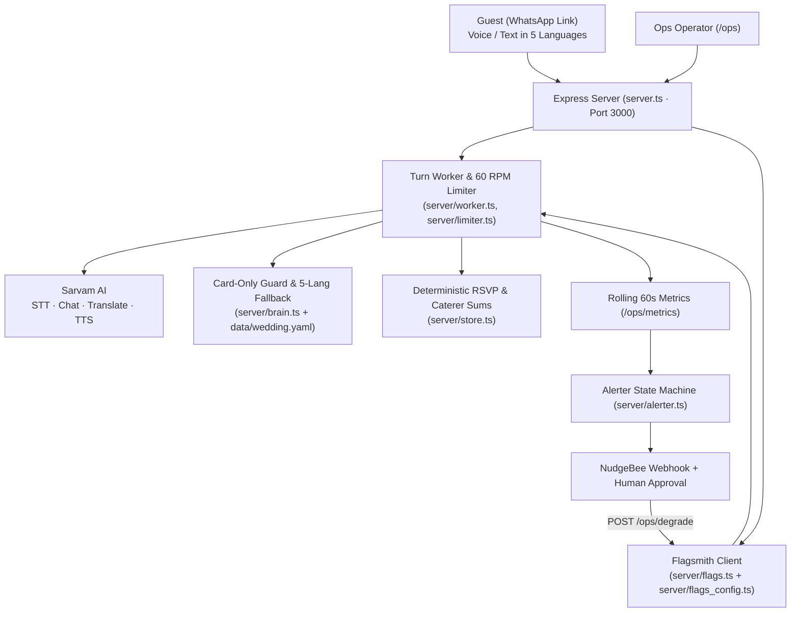

# HaanJi: Multilingual Wedding Season Concierge

[](https://www.typescriptlang.org/)
[](https://react.dev/)
[](https://expressjs.com/)
[](https://tailwindcss.com/)
[](LICENSE)

During Indian festive wedding season (Diwali to New Year), families answer hundreds of repeated guest calls about event timings, venues, parking, Jain food, and RSVPs, while elders struggle with English-only apps. **HaanJi** lets guests ask by voice or text in Hindi, Hinglish, English, Kannada, or Tamil, replies strictly from the wedding invitation card, sends RSVPs to the caterer only after the guest confirms, and protects upstream AI rate limits with Flagsmith and NudgeBee human approval.

- **Live App:** [https://haanji-eight.vercel.app](https://haanji-eight.vercel.app)
- **Repository:** [https://github.com/Nagaraj1399/HaanJi](https://github.com/Nagaraj1399/HaanJi)
- **Demo Video (2-3 min):** `[ADD_DEMO_VIDEO_URL_HERE]` (Tip: append `?demo=1` to open the guided recording checklist)
- **Team:** GenOS Team (Festive Hacks, BIEC Bengaluru)

---

## Screenshots & Demo Previews

| View | Preview Placeholder | What It Shows |
| :--- | :--- | :--- |
| **Guest Concierge** | `` | Festive hero framing, schedule, hold-to-ask mic, 5 language chips, 2-step RSVP confirmation |
| **Tamil Voice Answer** | `` | Tamil voice question answered and spoken in Tamil with Play/Stop and Elder Mode `0.85x` speed |
| **Ops Control Plane** | `` | 60 RPM Sarvam cap charts, Muhurat Rush demo timeline, Flagsmith catalog, and rollout slider |
| **NudgeBee Approval** | `` | Alert, cluster investigation, and human approval gate calling `POST /ops/degrade` |

---

## System Architecture



---

## How We Use the Sponsor Tools

### 1. Sarvam AI
HaanJi uses Sarvam AI across the full voice pipeline when `SARVAM_API_KEY` is configured:
- **Speech-to-Text (`saarika:v2.5`):** Transcribes hold-to-ask voice recordings and detects Indian languages automatically.
- **Chat (`sarvam-m`):** Answers guest questions strictly from `data/wedding.yaml` and extracts structured RSVP patches (`headcount`, `functions`, `diet.jain`, `needs_room`).
- **Translate (`mayura:v1`):** Ensures answers and family announcements match the guest's language (`hi`, `hinglish`, `kn`, `ta`, `en`), even if an intermediate reply was in English.
- **Text-to-Speech (`bulbul:v2`):** Speaks the reply back in the same language, slowed to `0.85x` when Elder Mode is ON.

### 2. Flagsmith
All flag names and defaults live in `server/flags_config.ts`. Guests can inspect live status in the `"How HaanJi works"` modal, and operators can inspect live values, defaults, controls, and `last_fetched_at` in the Ops `"Flags"` panel.

| Flag Key | Default Value | What It Controls |
| :--- | :--- | :--- |
| `ops_degradation_level` | `0` | Graceful degradation cascade: `0` Live voice, `1` Text replies (0 TTS), `2` Queued async drain |
| `ops_sarvam_rpm_budget` | `40` | Sliding-window upstream RPM budget (clamped between `5` and `55` RPM) |
| `exp_voice_persona` | `"formal"` | 50/50 multivariate A/B assignment per guest ID (`formal` vs `warm`), logging answers and confirmed RSVPs per arm |
| `rel_voice_reply` | `{"hi-IN":true,"en-IN":true,"kn-IN":true,"ta-IN":true}` | Per-language voice synthesis kill switch |
| `rel_voice_rollout_pct` | `100` | Percentage rollout (`0%` to `100%`) gating which guest IDs receive live voice replies |
| `rel_elder_mode_default` | `false` | Turns Elder Mode (large text, AAA contrast, `0.85x` audio pace) on by default for elder households (`IYER01`, `RAO05`) |
| `cfg_llm` | `{"model":"gemini-3.1-flash-lite","prompt_version":"v2.1-grounded","temperature":0.2,"max_tokens":450}` | Model ID, grounded prompt version, temperature, and token cap |

When Flagsmith is unreachable (or the `"Flagsmith Unreachable"` fault switch is enabled on `/ops`), all getters revert to safe contract defaults (`ops_degradation_level = 0`, `100%` voice rollout) and the guest page keeps working.

### 3. NudgeBee
During a wedding rush (such as the 9:30 AM Muhurat), `server/alerter.ts` watches the 60-second rolling error rate against Sarvam's 60 RPM cap:
1. **Alert:** When HTTP `429` errors cross `10%` (or p95 latency > `6s`), the alerter transitions `ok -> firing` and posts to `NUDGEBEE_EVENT_WEBHOOK_URL`.
2. **Investigate:** NudgeBee receives cluster evidence showing healthy pods (`14%` CPU, `0` restarts) and upstream quota saturation (so scaling workers would make errors worse).
3. **Human Approval:** Nothing mutates automatically. A human operator approves remediation, which calls `POST /ops/degrade` (with `X-Ops-Token`). If `NUDGEBEE_EVENT_WEBHOOK_URL` is not configured, the Ops Console explicitly labels local approval as **"Local rehearsal"**.
4. **Flag Changed & Guests Protected:** `ops_degradation_level` moves `0 -> 1`, TTS sheds to zero, `429` errors drop, and `"End surge"` restores `Level 0`.

---

## Setup & Deployment

### Prerequisites
- Node.js `20+` and `npm`
- Optional API keys for live sponsor mode (the app also works in offline card mode without keys)

### 1. Clone and Install
```bash
git clone https://github.com/Nagaraj1399/HaanJi.git
cd HaanJi
npm install
```

### 2. Configure Environment Variables
```bash
cp .env.example .env
```

All variables used by the app are listed in `.env.example`:

| Variable | Required? | Where To Get It |
| :--- | :--- | :--- |
| `SARVAM_API_KEY` | Live voice/AI | Sarvam AI Dashboard -> API Keys |
| `GEMINI_API_KEY` | Optional AI fallback | Google AI Studio -> API Keys (auto-injected in AI Studio) |
| `FLAGSMITH_ENV_KEY` | Optional live flags | Flagsmith Dashboard -> Environment -> Settings -> Client-side Environment Key |
| `FLAGSMITH_SERVER_KEY` | Optional server flags | Flagsmith Dashboard -> Environment -> Settings -> Server-side SDK Key |
| `FLAGSMITH_ADMIN_KEY` | Optional flag writes | Flagsmith Dashboard -> Account -> Keys |
| `FLAGSMITH_ENV_ID` | Optional flag writes | Flagsmith Dashboard -> Environment URL / Settings |
| `NUDGEBEE_EVENT_WEBHOOK_URL` | Optional live alerts | NudgeBee Workspace -> Integrations -> Incoming Event Webhook |
| `NUDGEBEE_API_TOKEN` | Optional NudgeBee auth | NudgeBee Workspace -> API Tokens |
| `HAANJI_HOST_KEY` | Optional (`random` if unset) | Self-chosen secret key for `/api/host/*` |
| `HAANJI_OPS_TOKEN` | Optional (`random` if unset) | Self-chosen secret token for `/ops/*` (`X-Ops-Token`) |
| `APP_URL` | Auto in hosting | Public URL of the deployed app |

### 3. Run Locally
```bash
npm run dev
```
Open `http://localhost:3000` (or `http://localhost:3000/?demo=1` for the guided video checklist, or `http://localhost:3000/?h=IYER01` for an elder household preview).

### 4. Deploy to Vercel
1. Import `github.com/Nagaraj1399/HaanJi` in Vercel.
2. Add the environment variables from `.env.example` under **Project -> Settings -> Environment Variables** (Production).
3. Click **Redeploy**.

---

## How To Verify

1. **Check Integrations (`/api/capabilities`):**
   Open `/api/capabilities` in your browser or run:
   ```bash
   curl http://localhost:3000/api/capabilities
   ```
   With keys set, `sarvam`, `flagsmith`, and `nudgebee` return `true` (cached for 60 seconds, `?refresh=1` forces a fresh probe). When a key is missing, its reason string explains why it is `false`.
2. **Test All 5 Languages:**
   Ask the 5 sample questions on Guest Concierge (Hinglish Sangeet, RSVP, Kannada Muhurat, Tamil Muhurat, English parking) and confirm each answer includes its matching language chip (`Hinglish`, `ಕನ್ನಡ`, `தமிழ்`, `English`).
3. **Run the Muhurat Rush Demo:**
   Open **Ops Control**, click **Run Muhurat Rush demo**, observe the 60 RPM breach and NudgeBee diagnosis, click **Approve** to shift Flagsmith `0 -> 1`, verify Guest Concierge switches to **"Voice is paused right now, please type"**, then click **End surge** to restore `Level 0`.
4. **Run Automated Tests & Lint:**
   ```bash
   npm run lint
   npm run build
   npm test
   ```

---

## Offline Mode (Zero Keys Required)

If no live AI keys (`SARVAM_API_KEY` or `GEMINI_API_KEY`) are set, HaanJi enters card-only offline fallback mode:
- `/api/capabilities` honestly reports `live_ai: false` and the reason.
- Guest text questions still work in all **5 languages** (`hi`, `hinglish`, `en`, `kn`, `ta`) using grounded card templates filled from `data/wedding.yaml`.
- RSVPs, 2-step confirmation (`Haan, confirm`), deterministic caterer sums, `.ics` calendar downloads, Host Desk, Ops Control Muhurat Rush rehearsal, and `?demo=1` all work end-to-end.

---

## API Endpoints

| Method & Path | Auth | Description |
| :--- | :--- | :--- |
| `GET /healthz` | Public | Health check returning service status and degradation level |
| `GET /api/capabilities` | Public | Real-probe status (`sarvam`, `gemini`, `live_ai`, `flagsmith`, `nudgebee`, reasons, last events) cached 60s |
| `GET /api/card?gid=...&h=...` | Public | Wedding card, household profile, Elder Mode default, voice rollout status, RSVP, and announcements |
| `POST /api/turn` | Public | Enqueue voice/text question (`413` over 2 MB or 30 s); returns `{ job_id, level, status }` |
| `GET /api/turn/:jobId` | Public | Poll turn result with localized answer, audio, language label, matched function, and trace |
| `POST /api/rsvp/:gid` | Public | Save and confirm manual RSVP edit |
| `POST /api/rsvp/:gid/confirm` | Public | Explicit guest confirmation (`Haan`) forwarding headcount to caterer tally |
| `GET /api/judge/state` | Public | Read-only live counters and caterer totals for `/judge` |
| `GET /api/host/state` | Host Key / Cookie (`403`) | Caterer tally, household nudge list, unanswered inbox, experiment summary |
| `GET /api/host/csv/:fnId` | Host Key / Cookie (`403`) | RFC-4180 CSV export per wedding function |
| `POST /api/host/add-to-card` | Host Key / Cookie (`403`) | Resolve unanswered question and append FAQ to live wedding card |
| `POST /api/host/announcement` | Host Key / Cookie (`403`) | Translate and publish a family update across languages |
| `GET /ops/metrics` | Public | Prometheus exposition metrics (`haanji_sarvam_requests_total`, etc.) |
| `GET /ops/state` | `X-Ops-Token` (`401`) | Full Ops telemetry, Flags catalog, workflows, and audit log |
| `POST /ops/degrade` | `X-Ops-Token` (`401`) | External NudgeBee remediation webhook target updating Flagsmith level and RPM budget |
| `POST /api/ops-proxy/*` | Internal Proxy | Ops UI actions (`muhurat-demo`, `end-surge`, `approve`, `reject`, `voice-rollout`, `sync-flags`, `reset`) |
| `POST /api/demo/reset` | Public (`?demo=1`) | Resets demo RSVPs, metrics, alerter, and flags back to defaults |
| `POST /api/tests/*` | Workbench | Runs Track A unit, Golden Set, Track B ops, causal loop, and API security suites |

---

## Project Structure

```text
haanji/
├── .env.example                 # Documented env vars for Sarvam, Flagsmith, NudgeBee, Gemini, Auth
├── server.ts                    # Express + Vite full-stack server (Port 3000)
├── data/
│   ├── wedding.yaml             # Demo wedding invitation card
│   └── wedding.test.yaml        # Frozen Golden Set snapshot
├── public/
│   └── assets/landing/          # Optimized WebP/MP4/PNG palace-luxury hero & venue assets
├── server/
│   ├── capabilities.ts          # Cached 60s real probes for Sarvam, Gemini, Flagsmith, NudgeBee
│   ├── flags_config.ts          # Central list of all 7 Flagsmith flag keys, defaults, and descriptions
│   ├── flags.ts                 # Flag evaluation, percentage rollout, A/B tracking, Flagsmith sync
│   ├── brain.ts                 # Language detector, 5-lang offline templates, Sarvam/Gemini live calls, postCheck()
│   ├── worker.ts                # Async turn pipeline, 413 guard, TTS gating, behind_answer trace
│   ├── limiter.ts               # Sliding-window RPM limiter & retry wrapper
│   ├── alerter.ts               # Surge alerter state machine & human-approval workflow
│   ├── store.ts                 # Deterministic RSVP validation & caterer headcount math
│   ├── routes_ops.ts            # /ops/* endpoints & Muhurat Rush demo controller
│   └── tests/                   # Unit, Golden Set, causal loop, and security suites
└── src/
    ├── App.tsx                  # Single-scroll wedding landing, ?h= household link, ?demo=1 checklist wrapper
    ├── types/haanji.ts          # Shared frontend TypeScript interfaces
    ├── utils/calendar.ts        # .ics calendar event download helper
    └── components/
        ├── GuestConcierge.tsx   # Guest UI: hold-to-ask voice/text, 5 languages, behind-answer trace, RSVP confirm
        ├── HostDashboard.tsx    # Family Host Desk: caterer totals, CSV, Answer-Once inbox, announcements
        ├── OpsControlPlane.tsx  # Ops UI: Muhurat Rush timeline, 7-flag catalog, rollout slider & A/B table
        ├── JudgeMode.tsx        # Read-only Judge Mode view
        ├── TestWorkbench.tsx    # Automated test runner UI
        ├── WeddingCardDrawer.tsx # Official invitation card quick-reference drawer
        └── DemoChecklist.tsx    # Hidden floating ?demo=1 recording checklist
```

---

## Known Limitations

- **In-memory persistence:** Demo RSVPs, unanswered questions, and audit logs live in server memory (`WeddingStore`) and reset on process restart or `POST /api/demo/reset`.
- **Single-replica demo server:** The Muhurat Rush generator simulates burst load against the in-process sliding-window limiter (`60 RPM` cap) rather than hitting external Sarvam endpoints with synthetic spam.
- **Browser audio fallback:** If `SARVAM_API_KEY` is unset (or during an upstream TTS error), voice playback falls back cleanly to browser speech synthesis or text-only responses depending on browser support.
- **Small A/B sample sizes:** The `exp_voice_persona` table marks small guest counts as statistically inconclusive rather than declaring a winner prematurely.

---

## License

MIT License. Built by **GenOS Team**.
