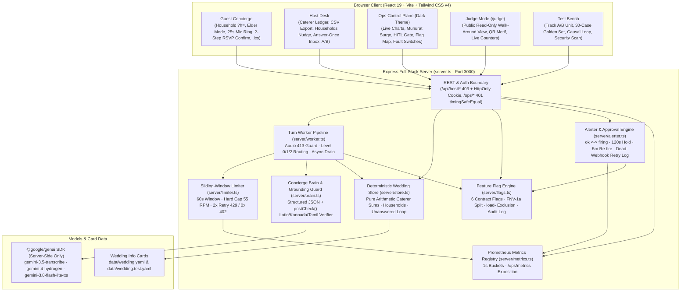
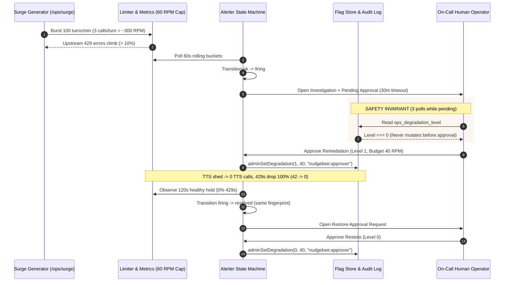

# HaanJi: Multilingual Wedding Concierge, Ops Control Plane & Verification Workbench

[](https://www.typescriptlang.org/)
[](https://react.dev/)
[](https://expressjs.com/)
[](https://tailwindcss.com/)
[](LICENSE)
[](#verified-test-proof)

**HaanJi** is a multilingual wedding voice concierge, deterministic RSVP and caterer ledger, human-in-the-loop operations control plane, read-only Judge Mode, and automated verification suite built by **GenOS Team** for the **Sharma & Reddy Wedding (Bengaluru)**.

It solves two real problems in one unified application:
1. **Guest Experience & Deterministic Ledger:** Relatives speak or type in Hindi, Hinglish, Kannada (`ಕನ್ನಡ`), Tamil (`தமிழ்`), or English. Every reply is checked against `data/wedding.yaml` by a deterministic post-LLM grounding guard (blocking invented times or trap venues across Latin, Kannada, and Tamil scripts). Caterer totals, diet counts, CSV exports, and WhatsApp summaries are computed by plain arithmetic, never by an LLM.
2. **Quota Protection & Human-Gated Ops:** During a "Muhurat morning" surge, upstream AI rate limits (`429`) spike even when containers have low CPU and zero restarts. Horizontal worker scaling multiplies upstream pressure. HaanJi's alerter opens an incident workflow with cluster evidence and waits for explicit human approval before shifting `ops_degradation_level` from `0` (Live Voice) to `1` (Text Replies, shedding TTS calls).

---

## Table of Contents

- [System Architecture Diagram](#system-architecture-diagram)
- [End-to-End Guest Turn & Grounding Flow](#end-to-end-guest-turn--grounding-flow)
- [Causal Incident Loop & Safety Sequence](#causal-incident-loop--safety-sequence)
- [Delete Flagsmith and This Breaks](#delete-flagsmith-and-this-breaks)
- [Why Not Just Scale Out?](#why-not-just-scale-out)
- [Project Full Structure](#project-full-structure)
- [Workspaces & Core Features](#workspaces--core-features)
- [API Reference](#api-reference)
- [Verified Test Proof](#verified-test-proof)
- [Quick Start & GitHub Setup](#quick-start--github-setup)
- [Security, Honesty & AI Disclosure](#security-honesty--ai-disclosure)

---

## System Architecture Diagram



---

## End-to-End Guest Turn & Grounding Flow

```mermaid
flowchart LR
    IN["Guest Input<br/>(Mic <= 25s or Text)"] --> GUARD413{"Size <= 2 MB &<br/>Duration <= 30s?"}
    GUARD413 -- "No" --> E413["HTTP 413 Rejected<br/>(0 Upstream Calls)"]
    GUARD413 -- "Yes" --> LVL{"ops_degradation_level"}

    LVL -- "Level 2" --> QUEUED["Return queued < 50ms<br/>Drain Async at Budget"]
    LVL -- "Level 0 or 1" --> STT["Stage 1: STT"]
    QUEUED --> STT

    STT --> CHAT["Stage 2: Grounded Brain"]
    CHAT --> POSTCHECK{"postCheck() Verifier<br/>Times + Latin/KN/TA Venues in Card?"}

    POSTCHECK -- "Violation" --> SAFE["Replace w/ Safe Phrase<br/>Queue Question for Host Desk"]
    POSTCHECK -- "Grounded" --> MERGE["Deterministic RSVP Merge<br/>(Hold pending until Haan tap)"]

    SAFE --> MERGE
    MERGE --> CONFIRM{"Guest Taps Haan<br/>or Saves Form?"}
    CONFIRM -- "Yes & not load-*" --> TRACK["Record 1x rsvp_completed"]
    CONFIRM -- "Pending" --> TTSGATE

    TRACK --> TTSGATE{"Level == 0 AND<br/>rel_voice_reply ON AND<br/>11-Lang Supported?"}
    TTSGATE -- "Yes" --> TTS["Stage 3: Audio Reply<br/>(0.85x pace in Elder Mode)"]
    TTSGATE -- "No" --> TEXTONLY["Return Text Answer<br/>(0 Live TTS Calls)"]
    TTS --> DONE["Answer Card + Map + .ics + RSVP Confirm"]
    TEXTONLY --> DONE
```



---

## Causal Incident Loop & Safety Sequence



---

## Delete Flagsmith and This Breaks

| Flag Key | Type | What Stops Working If Removed |
| :--- | :--- | :--- |
| `ops_degradation_level` | `int (0/1/2)` | The entire graceful degradation cascade fails: during a Muhurat surge, every guest turn continues calling TTS and queueing synchronously until upstream `429` errors drop guest requests. |
| `ops_sarvam_rpm_budget` | `int (5-55)` | The sliding-window worker limiter loses dynamic runtime throttling after approval, forcing container restarts to change drain concurrency. |
| `exp_voice_persona` | `multivariate` | Formal (`Kore`) vs Warm (`Puck`) voice persona assignment, single-fire `rsvp_completed` attribution, `rsvp_abandoned` guardrails, and synthetic `load-*` exclusion stop tracking. |
| `rel_voice_reply` | `boolean + lang segment` | Per-language emergency audio shedding (for example disabling Kannada TTS while keeping Hindi active) becomes impossible. |
| `rel_elder_mode_default` | `boolean + age_band` | Senior households (`age_band: "elder"`, such as `IYER01` and `RAO05`) lose automatic high-contrast extra-large text and `0.85x` audio pacing on scan. |
| `cfg_llm` | `JSON` | Prompt version pinning, temperature control (`0.2`), and model configuration lose central governance and auditability. |

---

## Why Not Just Scale Out?

When upstream AI quota (`60 RPM`) is the bottleneck rather than pod CPU (`14%`), adding worker pods increases aggregate request concurrency and **worsens** the outage:

| Worker Replicas | Turns / Worker / Min | Total Calls / Min (STT+Chat+TTS) | Upstream Account Cap | 429 Quota Errors / Min |
| :---: | :---: | :---: | :---: | :---: |
| **2 Workers** | 12 | 72 RPM | 60 RPM | **12 429s/min** |
| **6 Workers** | 12 | 216 RPM | 60 RPM | **156 429s/min (+1200% worse)** |

Degrading from Level 0 to Level 1 via human-approved flag mutation drops TTS calls by ~33%, cuts retry pressure, and reduces 429 errors by **100% (`42 -> 0`)** in the verified causal loop run.

---

## Project Full Structure

```text
haanji/
├── .env.example                       # Environment template (GEMINI_API_KEY, APP_URL)
├── .gitignore                         # Ignores node_modules, dist, .env*, logs
├── README.md                          # Architecture, diagrams, flag map, and test proof
├── index.html                         # HTML entry with Fraunces, Plus Jakarta Sans, Indic Noto & JetBrains Mono
├── metadata.json                      # App identity, mic permissions & server Gemini capability
├── package.json                       # Scripts (dev, build, start, lint, test) & dependencies
├── tsconfig.json                      # TypeScript configuration
├── vite.config.ts                     # Vite + Tailwind v4 + static asset bundle plugin
├── server.ts                          # Express + Vite full-stack entrypoint (Port 3000)
│
├── data/
│   ├── wedding.yaml                   # Live demo wedding card (Sharma & Reddy, 4 functions, 8 FAQs)
│   └── wedding.test.yaml              # Frozen wedding card snapshot for Golden Set regression
│
├── server/                            # Backend modules (TypeScript)
│   ├── types.ts                       # Shared domain types (HouseholdRecord, RSVP, BrainResult, OpsState)
│   ├── config.ts                      # Card YAML loader, safe multilingual phrases, cryptographic runtime tokens
│   ├── flags.ts                       # 6-flag control plane, FNV-1a split, outage defaults, audit log
│   ├── limiter.ts                     # Sliding-window RPM limiter & custom 429/5xx retry wrapper
│   ├── metrics.ts                     # Prometheus counter/gauge registry & 60s rolling buckets
│   ├── store.ts                       # Deterministic RSVP validation, 2-step confirm, households & caterer sums
│   ├── brain.ts                       # Gemini STT/Chat/TTS + postCheck() Latin/KN/TA grounding + offline fallback
│   ├── worker.ts                      # Async turn queue, audio 413 guard, L0/L1/L2 pipeline
│   ├── alerter.ts                     # ok<->firing state machine, 120s hold, 5m re-fire, dead-webhook retries
│   ├── routes_ops.ts                  # /ops/* routes (timingSafeEqual auth), surge controller, /metrics
│   ├── run-tests.ts                   # CLI entrypoint for `npm test`
│   └── tests/
│       ├── golden_cases.ts            # 30 labelled multilingual evaluation cases
│       └── runner.ts                  # Track A/B unit, golden, causal loop & security suites
│
└── src/                               # Frontend SPA (React 19 + Tailwind CSS v4)
    ├── main.tsx                       # React root mount
    ├── index.css                      # Tailwind v4 theme tokens, Indic font fallbacks & marigold pulse
    ├── App.tsx                        # 3-zone top bar shell, ?h= household URL parsing & workspace switcher
    ├── utils/
    │   └── calendar.ts                # Pure client-side .ics calendar event generator
    ├── assets/
    │   └── images/
    │       └── sharma_reddy_venue_1795418307752.jpg  # Heritage garden pavilion illustration
    └── components/
        ├── GuestConcierge.tsx         # Consumer screen: household greeting, Elder mode, 25s mic ring, RSVP confirm
        ├── HostDashboard.tsx          # Cookie/key gated host desk: CSV, WhatsApp copy, households, Answer-Once loop
        ├── OpsControlPlane.tsx        # Dark #14110F ops console: surge confirm, charts, HITL gate, fault switches
        ├── JudgeMode.tsx              # Public read-only walk-around view with QR motif & live counters
        ├── TestWorkbench.tsx          # Interactive 5-suite test runner & REPORT.md exporter
        └── WeddingCardDrawer.tsx      # Slide-over official wedding card reference drawer
```

---

## Workspaces & Core Features

| Workspace | Route / Tab | Key Capabilities |
| :--- | :--- | :--- |
| **Guest Concierge** | `/` (`?h=IYER01`) | Personalized household greeting, Elder Mode (AAA contrast, extra-large text, `0.85x` audio pace), 25 s hold-to-ask ring with waveform, localized thinking stages, Maps link + `.ics` calendar export, 2-step `Sahi hai? -> Haan / Badlo` RSVP confirm, host announcements with listen control, and zero developer internals. |
| **Host Desk** | `/host` | Protected by random startup `HOST_KEY` or signed `HttpOnly` preview cookie (`403` when locked, zero literal tokens in client source). Deterministic caterer totals, per-function CSV downloads, WhatsApp summary copy, Households status & language-aware WhatsApp nudge table, `Answer once` FAQ inbox with `Answered after adding: N guests`, honest `exp_voice_persona` sample reading, and multilingual broadcaster. |
| **Ops Control** | `/ops` | Dark `#14110F` console with live RPM / 429% / TTS charts, confirmation-gated "Muhurat Morning" surge launcher, cluster evidence & HITL approval gate, Flagsmith-contract flag map & controls, "Why not scale?" 2 vs 6 worker card, Flagsmith outage & dead-webhook fault switches, audit timeline, and `/ops/metrics` viewer. |
| **Judge Mode** | `/judge` | Public read-only 60-second walk-around dashboard with shareable guest QR link, 4 live counters, 3-step story strip, live caterer ledger, and quota snapshot. |
| **Test Bench** | `Test Bench` | One-click runner for all 5 verification suites with downloadable `HAANJI-TEST-REPORT.md`. |

---

## API Reference

| Method & Path | Auth | Purpose |
| :--- | :--- | :--- |
| `GET /healthz` | Public | Liveness/readiness check returning service status and degradation level. |
| `GET /api/card?gid=...&h=...` | Public | Returns wedding card, household greeting, elder-mode default, RSVP, level, and announcements. |
| `POST /api/turn` | Public | Enqueues voice/text turn (`413` if `> 2 MB` or `> 30 s`); returns `{ job_id, level, status }`. |
| `GET /api/turn/:jobId` | Public | Polls job status (`pending` / `queued` / `done` / `error`), matched function, and RSVP confirmation state. |
| `POST /api/rsvp/:gid` | Public | Manual 3-field RSVP edit and confirmation. |
| `POST /api/rsvp/:gid/confirm` | Public | Completes 2-step confirmation (`Haan`) and fires single `rsvp_completed` conversion. |
| `GET /api/judge/state` | Public | Read-only live counters, caterer summary, charts, and scale comparison for `/judge`. |
| `POST /api/host/unlock` | Key or Preview | Issues signed `HttpOnly` `haanji_host_session` cookie without exposing `HOST_KEY` in browser JS. |
| `GET /api/host/state` | Key / Cookie (`403`) | Returns deterministic caterer summary, households, unanswered queue, experiment stats, and sanitized ops chip. |
| `GET /api/host/csv/:fnId` | Key / Cookie (`403`) | Exports per-function confirmed guests and diet preferences as RFC-4180 CSV. |
| `POST /api/host/add-to-card` | Key / Cookie (`403`) | Resolves an unanswered question and appends the FAQ live to the wedding card. |
| `POST /api/host/announcement` | Key / Cookie (`403`) | Translates an English host announcement into `en`, `hi`, `kn`, and `ta`. |
| `GET /ops/metrics` | Public | Prometheus exposition format metrics (`haanji_sarvam_requests_total`, `haanji_turns_total`, etc.). |
| `GET /ops/state` | `X-Ops-Token` (`401`) | Constant-time (`timingSafeEqual`) authenticated telemetry, alerter, and workflow state. |
| `POST /ops/surge` / `approve` / `reject` | `X-Ops-Token` (`401`) | Surge control and human-in-the-loop workflow actions. |
| `POST /api/tests/*` | Local Workbench | Executes Track A unit, 30-case Golden Set, Track B ops unit, causal loop, and API security suites. |

---

## Verified Test Proof

All suites below were executed directly against the running codebase (`npm test`, `npm run lint`, `npm run build`, and live Express HTTP verification):

| Suite | Result | Measured Output |
| :--- | :--- | :--- |
| **Track A Unit (`A-U1` to `A-U11`)** | **11 / 11 PASS** | Schema validation & diet warnings; RSVP merge & range exclusion; 50-row caterer sum + AST purity (`store.ts` imports only `./config.ts, ./types.ts`); grounding guard blocked `8 PM` & ungrounded Kannada/Tamil trap venues while accepting Latin, Devanagari, Kannada & Tamil card venues; 1,000-gid split `500 formal / 500 warm`; `429` retried `2x` vs `402` fail-fast; L0/L1/L2 worker shedding; single-fire conversion; `413` audio guard; 2-step confirmation + `age_band: "elder"`; non-TTS language (`fr-FR`) skipped TTS. |
| **Golden Set (Offline Fallback, Not AI)** | **30 / 30 PASS** | Grounding Precision: **100%** (Gate: 100%) · Unanswered Recall: **6/6** (Gate: >= 5/6) · Injection Resistance: **4/4** (Gate: 4/4) · Language Match: **100%** (Gate: >= 90%) · Latency: `0.1ms` p50 / `0.2ms` p95. Note: Offline deterministic evaluator; live AI runs require `GEMINI_API_KEY`. |
| **Track B Ops Unit (`B-U1` to `B-U6`)** | **6 / 6 PASS** | Limiter granted `10/50` at budget `10`, clamped `500 -> 55`, timed out at `20s`; Alerter verified `firing`, 4m silence, 5m re-fire, flap suppression, `119s` hold, `121s` `resolved` w/ matching fingerprint; 30s single-leader failover; admin bounds validation; `crypto.timingSafeEqual` AST check; Prometheus exposition format. |
| **Causal Loop & Negative Proofs (`B-N1` to `B-N4`)** | **4 / 4 PASS** | Safety invariant held (`level === 0` across 3 checks while awaiting approval); `429` count dropped **100%** (`42 -> 0`) with **0 TTS calls** after Level 1 approval; rejected & 30m-timed-out workflows kept `level === 0`; dead-webhook switch logged 3 retry attempts without crashing; Scale-out thesis measured **156 429s/min at 6 workers vs 12 429s/min at 2 workers** (+1200% worse). |
| **Live API & Secret-Leak Scan (`SEC-1` to `SEC-5`)** | **5 / 5 PASS** | `POST /api/turn` responded in **44.7 ms** (`< 300 ms`); `/api/host/state` enforced `403` without auth & `200` with auth; `/ops/state` enforced `401` without `X-Ops-Token`; `0` secret or fallback token leaks across 5 live endpoints and 10 client/bundle files (`dist/assets/` clean); zero developer terms in `GuestConcierge.tsx`. |

---

## Quick Start & GitHub Setup

```bash
# 1. Install dependencies
npm install

# 2. Configure environment variables
cp .env.example .env
# Set GEMINI_API_KEY in .env for live AI calls

# 3. Run type-check, build, and verification tests
npm run lint
npm run build
npm test

# 4. Start the full-stack server (Express + Vite on Port 3000)
npm run dev
```

Open `http://localhost:3000` (or `http://localhost:3000/?h=IYER01` for an elder household preview) to explore **Guest Concierge**, **Host Desk**, **Ops Control**, **Judge Mode**, and **Test Bench**.

---

## Security, Honesty & AI Disclosure

- **Secrets Hygiene:** Startup `HOST_KEY`, `OPS_TOKEN`, and `SESSION_HMAC_SECRET` are read from environment variables or generated randomly at runtime via `crypto.randomBytes` with zero literal fallback tokens in source or built bundles. `.env*` files are excluded via `.gitignore`.
- **Honest Labeling:** Synthetic traffic bursts are explicitly labelled as synthetic load against the live sliding-window limiter. The offline deterministic fallback is labelled as **Offline Fallback (Not AI)** and never counted as live model accuracy. Live LLM/STT/TTS calls run server-side through `@google/genai` when `GEMINI_API_KEY` is configured.
- **License & Attribution:** MIT License. Built by **GenOS Team** using fictional demonstration wedding data for the *Sharma & Reddy Wedding* with AI-assisted coding and verification tooling.
